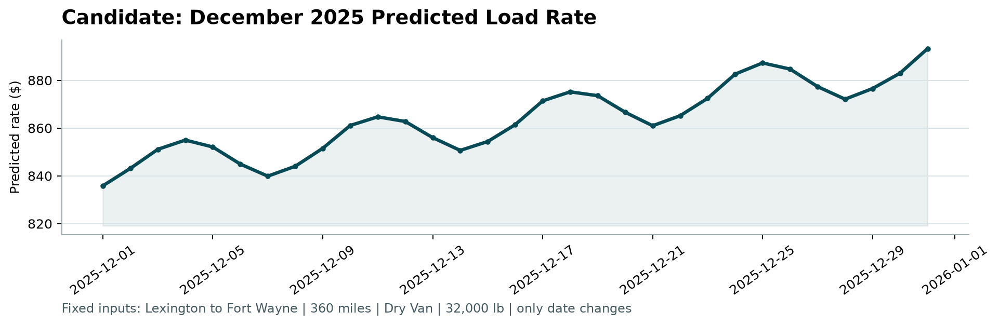

# Freight Rate Prediction

Predicts the posted rate (USD) of a freight load from its lane, distance, equipment, weight and date. Built for the Spotter Machine Learning Engineer assessment.

## Deliverables

| Deliverable | File |
|---|---|
| Predictions for the 12,000 Nov–Dec 2025 loads | [`validation_predictions.csv`](validation_predictions.csv) |
| December predictions for the fixed load | [`data/december_chart_inputs.csv`](data/december_chart_inputs.csv) |
| December chart produced by `score.py` | [`scorer_results/candidate_december.png`](scorer_results/candidate_december.png) |
| Report: validation, data split and December chart | [`reports/report.pdf`](reports/report.pdf) ([DOCX](reports/report.docx)) |
| Exploratory analysis | [`notebooks/01_eda.ipynb`](notebooks/01_eda.ipynb) |



## Approach in brief

1. **Clean the inputs.** Fix negative weights (sign errors) and fill missing weights. Fill missing `market_index` with that day's median (it is a daily signal). Look up city coordinates for the December file. Remove about 1.4% broken prices (2–7× off their expected value) from training.
2. **Drop `quote_signal`.** It equals price per mile in some months, mirrors it in others, and is pure noise in Nov–Dec. A check that needs no labels (its correlation with distance) shows this. A model that used it would look great on a random split and fail on Nov–Dec.
3. **Validate by time.** Three rolling folds each train on the past and predict the next two months, the same shape as Jan–Oct → Nov–Dec. Models are compared on mean and worst-fold MAE.
4. **Model.**
   - A 70/30 average of LightGBM and a log-linear model, both on log(rate), prices each load from its attributes.
     LightGBM uses coordinates rather than city names, so new cities still get a price.
   - A **market price level** shared by all loads on a day is added on top: the recent level carried forward, plus the yearly upward trend, plus a ~4% ramp over the last four weeks of each quarter.
   - The validation `market_index` values give each future day its weekly cycle.

## Results

Time-based backtest: mean of 3 folds, each predicting the two months after its training data. Scores are on clean test loads.

| Model | MAE | Worst fold MAE | MAPE |
|---|---|---|---|
| **Blend + market level (selected)** | **$44.5** | **$51.4** | **1.89%** |
| LightGBM + market level | $45.8 | $54.7 | 1.96% |
| LightGBM + recent level only | $56.4 | $62.1 | 2.38% |
| LightGBM (no market level) | $77.5 | $117.6 | 3.24% |
| Naive $/mile baseline | $105.7 | $148.0 | 4.59% |

Full per-fold results, including RMSE, bias and scores on all loads with broken prices kept, are in `reports/backtest_results.csv`. The final model is retrained on all 47,323 clean Jan–Oct loads.

## Project structure

```
.
├── data/                  # Provided CSVs (only the filled December file is committed; see "Data")
├── notebooks/01_eda.ipynb # Exploratory analysis with charts
├── src/
│   ├── config.py          # Paths and constants
│   ├── data.py            # Loading, cleaning, outlier detection
│   ├── features.py        # Feature engineering (shared by train/validation/December)
│   ├── split.py           # Time-based folds and metrics
│   ├── models.py          # Baselines, LightGBM, market price level
│   ├── train.py           # Backtest candidates, train and save the final model
│   ├── diagnostics.py     # Evidence for the split, quote_signal and unseen-city decisions
│   ├── predict.py         # Validation and December chart predictions
│   └── report.py          # Builds reports/report.docx and .pdf
├── tests/                 # pytest suite (reuses score.py's validators)
├── reports/               # Report, figures, backtest and diagnostics results
├── scorer_results/        # December chart written by score.py
├── score.py               # Provided scorer (unchanged)
└── validation_predictions.csv   # Final submission
```

## Setup

Requires Python 3.11+.

```bash
python -m venv .venv
.venv\Scripts\activate          # Windows
# source .venv/bin/activate     # macOS / Linux
python -m pip install -r requirements.txt        # pipeline only
python -m pip install -r requirements-dev.txt    # + tests, notebook, report
```

## Data

Place the four provided files in `data/` (overwriting the committed December file is fine; `src.predict` fills it again):

```
data/train_test.csv
data/validation.csv
data/validation_predictions_template.csv
data/december_chart_inputs.csv
```

## Run

```bash
python -m src.train          # backtest all candidates, train the final model (~4 min)
python -m src.diagnostics    # split / quote_signal / unseen-city evidence (~2 min)
python -m src.predict        # writes validation_predictions.csv and fills predicted_rate in data/december_chart_inputs.csv
python score.py --predictions validation_predictions.csv --december-predictions data/december_chart_inputs.csv
python -m pytest             # tests
```

`score.py` validates both prediction files and writes `scorer_results/candidate_december.png`.

Optional: re-run the notebook with `python -m nbconvert --to notebook --execute --inplace notebooks/01_eda.ipynb`, then rebuild the report with `python -m src.report` (PDF export needs Microsoft Word).
